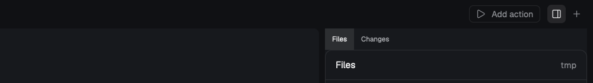

# herdr-t3-panel

Herdr's own **Files** and **Changes** panels for the [Herdr T3](https://github.com/JinJieBeWater/herdr-t3) layout, with a toggle button in T3's tab bar and `cmd-shift-e`.

Herdr's default layout (`main`) has Files and Changes on the right; Herdr T3 leaves them out. This adds them back as a hidden panel on the right of T3's work area, with Files and Changes as tabs at its top, and a button between **Add action** and **+** to show or hide it.



## Install

Tell your Herdr agent:

```text
Read ~/.config/herdr-app/AGENTS.md, then add this mod: https://github.com/carstenlucke/herdr-t3-panel/tree/main
```

It needs the Herdr T3 layout (`layouts/herdr-t3.json`) installed. What the agent does, also by hand:

1. Copy `mods/t3-panel-toggle` to `~/.config/herdr-app/mods/`.
2. Merge `keys.json` into `~/.config/herdr-app/keys.json` (adds `cmd-shift-e` to the `layout:herdr-t3` section; ask before replacing a key you already use there).
3. Add the two layout nodes below to `~/.config/herdr-app/layouts/herdr-t3.json`.
4. `herdr-app check ~/.config/herdr-app/mods/t3-panel-toggle`, then `herdr-app status` shows no errors.

### Layout nodes

In the `tabs-row` row, right before the `tabs-end` block:

```json
{ "id": "panel-toggle", "type": "block", "size": { "px": 30 }, "window_drag": true, "content": { "mod": "t3-panel-toggle" } },
```

In the `work-body` row, after the `main` block:

```json
{
  "id": "panel",
  "type": "column",
  "hidden": true,
  "size": { "px": 368 },
  "min": 280,
  "max": 900,
  "background": "background",
  "radius": 8,
  "children": [
    {
      "id": "panel-body",
      "type": "stack",
      "active": "files",
      "header": { "content": "tabs", "height": 30 },
      "children": [
        { "id": "files", "title": "Files", "type": "block", "content": { "mod": "files" } },
        { "id": "changes", "title": "Changes", "type": "block", "content": { "mod": "changes" } }
      ]
    }
  ]
}
```

## Use

- The button (a panel icon, between **Add action** and **+**) or `cmd-shift-e` shows or hides the panel. While it's open, the button has a light ground.
- The tabs at the panel's top switch between Files and Changes. Drag the panel's edge to resize it.
- The panel follows the space you're in. Changes needs the space's folder to be a git repo.

## Updating Herdr T3

The panel and the button live in T3's layout file. If a T3 update replaces `layouts/herdr-t3.json`, add the two nodes again; the mod and the key stay.

## What it runs

Nothing. The mod only reads the layout and runs `layout.toggle` on the `panel` node. Files and Changes are Herdr's own shipped mods.

## License

MIT
