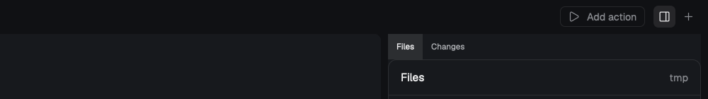

# herdr-t3-panel

Herdr's shipped Files and Changes panels on the right of the Herdr T3 layout, opened and closed by a small button in T3's tab bar (between Add action and +) or `cmd-shift-e`. Closed by default; open, it shows Files and Changes as tabs.

## What you see

- **Toggle button** in T3's tab bar (`tabs-row`, 40px, `chrome`): a 30px block between `actions` and `tabs-end`, holding a 26×26 button, radius 6, centered. Its icon is Lucide `panel-right` (24 grid, 1.75px stroke), drawn at 14px. Closed: `chrome` ground, `muted` icon. Open: `selected` ground, `foreground` icon. Hover: `hover` ground, `foreground` icon. Tooltip: `Show Files / Changes (⇧⌘E)` or `Hide Files / Changes (⇧⌘E)`.
- **Panel** at the right of `work-body`, after the panes, separated by `work-body`'s 8px gap: 368px wide (280–900, resizable by its edge), `background` ground, radius 8, as T3's framed panes. At its top a 30px built-in tab strip with `Files` and `Changes`; under it the shown one: Herdr's `files` mod (the space's folder tree, with the space's name at the right of its header) or `changes` mod (the space's git changes).

## How it behaves

- A click on the button, or `cmd-shift-e`, runs `layout.toggle { id: "panel" }`. The button follows the panel's `hidden` state on every render, so it is right whichever way the panel was opened.
- The tab strip switches the stack's active child; Herdr remembers which one and the panel's width and shown state as layout clicks (`layouts/.state/`).
- The panel follows the focused space. Changes is empty when the space's folder isn't a git repo.
- No agent status is shown; the button has no states besides open and closed.

## Built from

- **Mod `t3-panel-toggle`** (`mods/t3-panel-toggle/`): `mod.json` `{ "place": "none", "title": "Panel toggle" }`; `main.js` a `View` that reads `layout()` and finds the node with id `panel` (recursive over `children`), and `theme()` for colors; the button's `on_click` is `run("layout.toggle", { id: "panel" })`, its `on_mouse_down("left")` stops propagation so the bar's `window_drag` doesn't take the press. Art: `panel-right.svg`.
- **Layout `herdr-t3.json`** (the person's T3 layout, extended): in `tabs-row`, before `tabs-end`: `{ "id": "panel-toggle", "type": "block", "size": { "px": 30 }, "window_drag": true, "content": { "mod": "t3-panel-toggle" } }`. In `work-body`, after `main`: a `column` `panel` (`hidden: true`, `size.px` 368, `min` 280, `max` 900, `background: "background"`, `radius: 8`) with one `stack` `panel-body` (`active: "files"`, `header: { "content": "tabs", "height": 30 }`) whose children are the blocks `files` (`title: "Files"`, mod `files`) and `changes` (`title: "Changes"`, mod `changes`).
- **Keys** (`keys.json`): `layout:herdr-t3` → `"cmd-shift-e": "layout.toggle:panel"`.
- **Shipped mods used:** `files`, `changes`. **Commands:** `layout.toggle`. **Programs run:** none.

## Watch out

- A stack's built-in tab strip is `"header": { "content": "tabs", "height": 30 }`. The bare string `"header": "tabs"` is rejected (`expected struct Header`), and `{ "tabs": true }` too.
- Without a `title` on each stack child the strip labels them `1` and `2`. `title` is the field it reads (`label` is ignored).
- The node ids `panel` and `panel-body` match Herdr's `main` layout, so the same names work for both; the button looks for `panel` only.
- `tabs-row` is `resizable: false` and its blocks size themselves; give the toggle a fixed `px`, not a weight, or it takes the tab strip's room.
- This lives in T3's layout file: a T3 update that replaces it drops both nodes (the mod and key stay).

## Done when

- `herdr-app check ~/.config/herdr-app/mods/t3-panel-toggle` passes and `herdr-app status` shows `"errors": []` with `herdr-t3` shown.
- The button sits between Add action and +; a click opens the panel on the right and the button gets a light ground; another click closes it.
- `cmd-shift-e` does the same while `herdr-t3` shows.
- The panel's tabs read `Files` and `Changes`; Files lists the focused space's folder; Changes lists git changes in a repo space.
